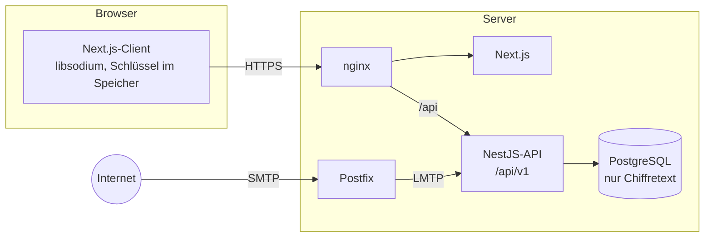

<p align="center">
  <a href="README.md">English</a> · <a href="README.ru.md">Русский</a> · <b>Deutsch</b>
</p>

<p align="center">
  
</p>

<h1 align="center">ShadowBox</h1>

<p align="center">
  <b>Anonyme Mail, die deine Nachrichten nicht lesen kann.</b><br>
  Keine Telefonnummer, kein Name. Eine eigene Adresse für jede Website. Verschlüsselt im Moment des Empfangs.
</p>

<p align="center">
  
  
  
  
  
  
</p>

<p align="center">
  <a href="#screenshots">Screenshots</a> ·
  <a href="#so-funktioniert-es">So funktioniert es</a> ·
  <a href="#bedrohungsmodell">Bedrohungsmodell</a> ·
  <a href="#technologien">Technologien</a> ·
  <a href="#lokal-starten">Lokal starten</a> ·
  <a href="https://github.com/alexandra-seredkina/ShadowBox-Frontend">Frontend</a>
</p>

---

## Über das Projekt

**ShadowBox** ist ein Mail-Dienst, der nicht weiß, wer du bist, und deine Mail nicht lesen kann.

Zur Registrierung reichen Login und Passwort. Für jede Website legst du eine eigene Adresse an: eine für den Shop, eine für die Bank, eine für das Forum. Eine eingehende Nachricht wird im Moment des Empfangs mit deinem Schlüssel verschlüsselt, auf dem Server bleibt nur Chiffretext, und entschlüsseln lässt sie sich nur in deinem Browser nach Eingabe deines Passworts. Verdächtige Nachrichten werden markiert, bevor du sie öffnest.

Das Projekt besteht aus zwei Repositorys:

| Repository | Inhalt |
| --- | --- |
| **ShadowBox-Backend** (du bist hier) | NestJS-API, PostgreSQL, Mail-Empfang, nginx und die Docker-Umgebung |
| [ShadowBox-Frontend](https://github.com/alexandra-seredkina/ShadowBox-Frontend) | Next.js-Webclient: Website, Registrierung, Postfach, Kryptografie im Browser |

## Screenshots

<p align="center">
  
</p>

<table>
  <tr>
    <td width="50%"></td>
    <td width="50%"></td>
  </tr>
  <tr>
    <td width="50%"></td>
    <td width="50%"></td>
  </tr>
</table>

<p align="center">
  <br>
  <sub>Die Website auf Englisch, Russisch und Deutsch, mobile Ansicht</sub>
</p>

## Warum

Wie viele Konten hängen an deiner E-Mail-Adresse? Fast jeder Dienst verlangt sie bei der Registrierung und setzt darüber das Passwort zurück. Der Schlüssel zu deinem Postfach ist der Schlüssel zu deinem ganzen digitalen Leben: Wer ein Postfach übernimmt, kommt an fast alle Dienste, Dokumente und Unterhaltungen.

Und wem vertrauen wir diese Mail an? [Yandex räumte ein](https://yandex.ru/company/news/2021-02-12), dass ein Mitarbeiter unbefugt auf 4.887 Postfächer zugegriffen hat. [Google bestätigte](https://www.bbc.com/news/technology-44699263), dass Entwickler von Drittanbieter-Apps Nachrichten von Nutzern lesen können und dass das nicht gegen seine Richtlinien verstößt.

## Ziele

Prioritäten in dieser Reihenfolge: **Sicherheit → Anonymität → Komfort**.

- 🔐 **Zero Access.** Der Server speichert nur Chiffretext. Weder ein Administrator noch ein gestohlenes Backup noch ein geleakter Datenbank-Dump können deine Mail lesen.
- 🕶 **Minimale Daten.** Keine Telefonnummer, kein Name, keine Ersatzadresse. IP-Adressen werden nie im Klartext gespeichert, in den Logs steht nichts Unnötiges.
- ✉️ **Eine Adresse für jeden Zweck.** Zufällige Adressen hängen weder mit deinem Login noch miteinander zusammen. Eine geleakte Adresse löschst du mit einem Klick, und sie wird nie wieder vergeben.
- 🛡 **Schutz vor Phishing.** SPF, DKIM, DMARC und Heuristiken gegen gefälschte Absender, irreführende Links und gefährliche Anhänge.
- 🤝 **Ehrlichkeit.** Wir schreiben ausdrücklich dazu, wovor der Dienst *nicht* schützt. Keine „100 % Anonymität“, keine „Verschlüsselung auf Militärniveau“.
- 🔎 **Überprüfbarkeit.** Offener Code unter AGPL-3.0, SAST und Abhängigkeitsprüfung bei jedem Pull Request.

## So funktioniert es

<p align="center">
  
</p>

1. **Registrierung.** Statt eines Captchas löst der Browser eine kleine Proof-of-Work-Aufgabe, erzeugt ein X25519-Schlüsselpaar und zeigt eine Wiederherstellungsphrase. Das Passwort erreicht den Server nie: Der Browser leitet daraus `authKey` (zum Anmelden) und `encKey` (öffnet den privaten Schlüssel) ab.
2. **Adressen.** Du legst dauerhafte oder temporäre Adressen an (1 h, 24 h, 7 oder 30 Tage). Beschriftungen von Adressen und Ordnernamen werden im Browser verschlüsselt.
3. **Empfang.** Externes SMTP → Postfix → LMTP → Modul `delivery`. Im Arbeitsspeicher prüft der Server SPF/DKIM/DMARC, setzt Bedrohungslabels, verschlüsselt Vorschau und gesamte Nachricht mit dem öffentlichen Schlüssel des Empfängers und speichert nur den Chiffretext.
4. **Lesen.** Der Browser holt den Chiffretext, entschlüsselt ihn mit dem Schlüssel im Arbeitsspeicher und zeigt HTML-Mails in einem isolierten `iframe` ohne Skripte und externe Bilder.

> [!NOTE]
> Mail von gewöhnlichen Anbietern kommt per SMTP im Klartext an — so funktioniert das Protokoll. Der Server sieht eine Nachricht im Moment des Empfangs, vor der Verschlüsselung, und er sieht Metadaten: Zeit, Empfängeradresse und Größe. „Admins see nothing“ auf dem Schema bezieht sich auf den Inhalt der Nachrichten im Speicher.

## Funktionen des MVP

| | Funktion | Status |
| --- | --- | :---: |
| 👤 | Registrierung mit Login und Passwort, Proof-of-Work statt Captcha | 🚧 |
| 🔑 | Schlüssel entstehen im Browser, der private Schlüssel lebt nur im Speicher des Tabs | 📋 |
| ✉️ | Dauerhafte und temporäre Adressen, Beschriftungen, Ordner für eingehende Mail | 📋 |
| 📥 | Mail-Empfang mit Verschlüsselung im Moment des Eingangs | 📋 |
| 🛡 | Bedrohungslabels und SPF/DKIM/DMARC-Ergebnisse in verständlicher Sprache | 📋 |
| 🗂 | Ordner, Sammelaktionen, Suche über entschlüsselte Mail auf dem Client | 📋 |
| 💻 | Sitzungsliste, jede Sitzung beenden, optionale Bindung der Sitzung an die IP | 📋 |
| 🌍 | Website auf Englisch, Russisch und Deutsch | ✅ |

✅ fertig · 🚧 in Arbeit · 📋 geplant

**Nach dem MVP:** Mail versenden (zuerst Ende-zu-Ende zwischen ShadowBox-Nutzern, dann ins Internet), 2FA (TOTP und Passkeys), Wiederherstellung mit der Wiederherstellungsphrase, PGP, ein Bild-Proxy, Umstieg auf OPAQUE.

### Was im Backend schon steht

- Striktes TypeScript und ein typbewusster Linter, Umgebung per `zod`-Schema geprüft — mit kaputter Konfiguration startet die App nicht.
- Strukturierte `pino`-Logs mit Redact-Liste, `requestId` in jeder Antwort, ein einheitliches Fehlerformat für die gesamte API.
- Datenbankschema für das MVP: UUIDv7, `timestamptz`, Integrität durch PostgreSQL erzwungen (eine Adresse wird nie zweimal vergeben, eine Nachricht landet nie im Ordner eines anderen).
- Versionierte API unter `/api/v1`, `Origin`-Prüfung bei ändernden Anfragen, Größenlimit für Anfragen.
- Erste Anmelde-Endpunkte: `POST /auth/pow` (Proof-of-Work-Aufgabe) und `POST /auth/prelogin` (KDF-Parameter; ein unbekannter Login bekommt plausible Scheinwerte, damit niemand prüfen kann, ob er vergeben ist).
- Registrierung `POST /auth/register`: Der Server speichert nur einen Argon2id-Hash von `authKey`; Konto, Systemordner, erste Adresse und Sitzung entstehen in einer Transaktion; eine Wiederholung mit `Idempotency-Key` ist sicher. Die Sitzung ist ein `HttpOnly`-`__Host-`-Cookie, in der Datenbank liegen nur der SHA-256 des Tokens und ein HMAC der IP.
- Kryptografische Testvektoren, die mit dem Webclient geteilt werden: Gleiche Eingaben ergeben im Browser und auf dem Server dieselben Bytes.
- nginx ohne falsche Header und ohne Versionen in `Server`.

## Bedrohungsmodell

Als Gegner gelten auch der Serverbetreiber, eine geleakte Datenbank und ein gestohlenes Backup. Jede Entscheidung wird an einer Frage gemessen: *Was erfährt ein Angreifer aus einem vollständigen Dump von Datenbank, Logs und Festplatte?*

| Bedrohung | Was schützt | |
| --- | --- | :---: |
| Leak der Datenbank oder eines Backups | Nachrichten, Betreffzeilen, Adressbeschriftungen und Ordnernamen nur als Chiffretext | ✅ |
| Neugieriger Administrator | Schlüssel zum Entschlüsseln gibt es nur im Browser des Nutzers | ✅ |
| Passwortraten und Massenregistrierung | Argon2id, Proof-of-Work, Rate Limiting, gleiche Antwort für „Login unbekannt“ und „falsches Passwort“ | ✅ |
| Sitzungsdiebstahl per XSS | `HttpOnly`-`__Host-`-Cookie, `SameSite=Strict`, CSP mit Nonce, erneute Passworteingabe für gefährliche Aktionen | ✅ |
| Deanonymisierung über die Registrierung | Keine Telefonnummer, kein Name, keine E-Mail; IPs nur als HMAC mit rotierendem Schlüssel, höchstens 30 Tage | ✅ |
| Tracking-Pixel und Phishing | Externe Bilder ausgeblendet, HTML im isolierten `iframe`, Bedrohungslabels | ✅ |
| Metadaten: wer, an wen, wann | Zeit, Empfängeradresse und Größe sieht der Server | ⚠️ |
| Der externe Absender und sein Anbieter | Sehen die Nachricht, bevor sie bei uns ankommt | ❌ |
| Der Server tauscht das JavaScript des Webclients aus | Der Code ist offen, aber der Webclient lädt JS vom Server | ⚠️ |
| Kompromittiertes Gerät des Nutzers | Liegt außerhalb dessen, was der Dienst schützen kann | ❌ |

Das Modell beschreibt die Zielarchitektur des MVP; was schon umgesetzt ist, steht in der Funktionstabelle oben.

## Architektur



Das Backend ist ein modularer Monolith: Module nach fachlichen Fähigkeiten (`identity`, `alias`, `folder`, `message`, `threat`, `delivery`), jedes mit den Schichten `domain → application → infrastructure / presentation`. Die Schichtgrenzen prüft der Linter.

```
src/
├── config/            Umgebungsschema und typisierte Konfiguration
├── shared/            Fehler, Kernel-Typen, HTTP-Grundlagen
├── infrastructure/    Prisma, Kryptografie, Logging
├── modules/
│   ├── identity/      Registrierung, Anmeldung, Sitzungen
│   ├── alias/         dauerhafte und temporäre Adressen
│   ├── folder/        Ordner
│   ├── message/       Nachrichten, verschlüsselt gespeichert
│   ├── threat/        Bedrohungslabels
│   └── delivery/      Mail-Empfang per LMTP
└── health/            /api/health
```

## Technologien

| Schicht | Stack |
| --- | --- |
| **API** | NestJS 12 (ESM), striktes TypeScript, zod, pino, helmet |
| **Daten** | PostgreSQL 18, Prisma 7, UUIDv7, `timestamptz` |
| **Kryptografie** | libsodium: Argon2id, X25519, XChaCha20-Poly1305 (`crypto_box_seal`) |
| **Mail** | Postfix → LMTP (`smtp-server`), `mailauth` für SPF/DKIM/DMARC, `postal-mime` |
| **Webclient** | Next.js 16, React 19, Tailwind CSS 4, `libsodium-wrappers-sumo` — [mehr](https://github.com/alexandra-seredkina/ShadowBox-Frontend) |
| **Infrastruktur** | Docker Compose, nginx, Ports nur auf `127.0.0.1` |
| **Qualität** | Vitest (Unit, Integration, E2E), oxlint mit typbewussten Regeln, Semgrep, `npm audit`, Dependabot |

## Lokal starten

Du brauchst Docker mit Compose und beide Repositorys nebeneinander:

```
ShadowBox/
├── ShadowBox-Backend/
└── ShadowBox-Frontend/
```

```bash
cp .env.example .env    # eigenes POSTGRES_PASSWORD, PRELOGIN_SALT_KEY, IP_HASH_KEY und SENDER_HASH_KEY setzen
docker compose up --build
```

| Adresse | Was |
| --- | --- |
| http://localhost:8080 | Website und Webclient über nginx |
| http://localhost:8080/api/health | Zustand von API und Datenbank |
| `127.0.0.1:5433` | PostgreSQL für Prisma Studio und Migrationen vom Host |
| `127.0.0.1:2424` | LMTP des Dienstes `delivery`, der eingehende Mail übernimmt |

Öffne genau `localhost` oder `127.0.0.1`: Browser behandeln sie als sicheren Kontext, deshalb funktionieren `Secure`-Cookies ohne HTTPS. Die Mail-Domain in der Entwicklung ist `shadowbox.test`; sie kommt aus einer Umgebungsvariable und steht nirgends fest im Code.

Der Code beider Repositorys wird in die Container gemountet und lädt bei Änderungen neu. Nach geänderten Abhängigkeiten die Container mit frischen Volumes neu bauen:

```bash
docker compose up --build -V
```

Eine neue Migration nach Änderungen an `prisma/schema.prisma`:

```bash
npx prisma migrate dev --name <name>
```

### Prüfungen

```bash
npm run typecheck
npm run lint
npm test
npm run test:integration   # braucht DATABASE_URL einer Wegwerf-Datenbank
npm run test:e2e
```

Dasselbe läuft in der CI bei jedem Pull Request, dazu Semgrep und `npm audit`.

## Mitmachen und Sicherheit

Ideen, Kritik und Pull Requests sind willkommen. Sicherheit steht an erster Stelle, Anonymität an zweiter.

Eine Schwachstelle gefunden? Bitte kein öffentliches Issue — reiche auf GitHub eine [private Schwachstellenmeldung](https://github.com/alexandra-seredkina/ShadowBox-Backend/security/advisories/new) ein.

## Lizenz

[AGPL-3.0](LICENSE). Wenn du eine veränderte Version von ShadowBox als Dienst betreibst, muss der Quellcode deiner Änderungen für dessen Nutzer verfügbar sein.
