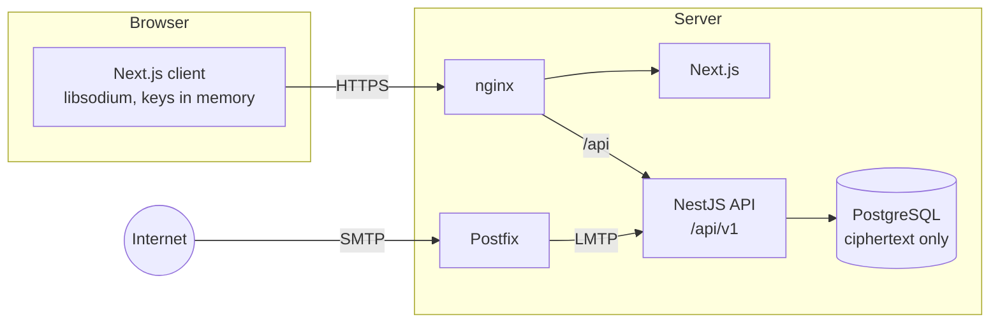

<p align="center">
  <b>English</b> · <a href="README.ru.md">Русский</a> · <a href="README.de.md">Deutsch</a>
</p>

<p align="center">
  
</p>

<h1 align="center">ShadowBox</h1>

<p align="center">
  <b>Anonymous mail that cannot read your messages.</b><br>
  No phone number, no name. A separate address for every site. Encrypted the moment it arrives.
</p>

<p align="center">
  
  
  
  
  
  
</p>

<p align="center">
  <a href="#screenshots">Screenshots</a> ·
  <a href="#how-it-works">How it works</a> ·
  <a href="#threat-model">Threat model</a> ·
  <a href="#tech-stack">Tech stack</a> ·
  <a href="#running-locally">Running locally</a> ·
  <a href="https://github.com/alexandra-seredkina/ShadowBox-Frontend">Frontend</a>
</p>

---

## About

**ShadowBox** is a mail service that does not know who you are and cannot read your mail.

Signing up takes a login and a password, nothing else. You create a separate address for every site: one for the shop, another for the bank, a third for the forum. An incoming message is encrypted with your key the moment it is received, the server keeps only ciphertext, and it can be decrypted only in your browser after you enter your password. Suspicious messages are flagged before you open them.

The project lives in two repositories:

| Repository | What is inside |
| --- | --- |
| **ShadowBox-Backend** (you are here) | NestJS API, PostgreSQL, mail intake, nginx and the Docker setup |
| [ShadowBox-Frontend](https://github.com/alexandra-seredkina/ShadowBox-Frontend) | Next.js web client: website, sign-up, inbox, in-browser cryptography |

## Screenshots

<p align="center">
  
</p>

<table>
  <tr>
    <td width="50%"></td>
    <td width="50%"></td>
  </tr>
  <tr>
    <td width="50%"></td>
    <td width="50%"></td>
  </tr>
</table>

<p align="center">
  <br>
  <sub>The site in English, Russian and German, mobile layout</sub>
</p>

## Why

How many accounts are tied to your email? Almost every service asks for it at sign-up and uses it to reset your password. The key to your mailbox is the key to your whole digital life: whoever gets one inbox gets into nearly every service, document and conversation.

And who do we trust with that mail? [Yandex admitted](https://yandex.ru/company/news/2021-02-12) that an employee gained unauthorised access to 4,887 mailboxes. [Google confirmed](https://www.bbc.com/news/technology-44699263) that third-party app developers can read users' messages and that this does not break its policy.

## Goals

Priorities, in this order: **security → anonymity → convenience**.

- 🔐 **Zero access.** The server stores only ciphertext. Neither an administrator, nor a stolen backup, nor a leaked database dump can read your mail.
- 🕶 **Minimal data.** No phone number, name or backup email. IP addresses are never stored in plain form, logs carry nothing they do not need.
- ✉️ **An address for every occasion.** Random addresses are tied neither to your login nor to each other. A leaked address is deleted in one click and never handed to anyone else.
- 🛡 **Phishing protection.** SPF, DKIM, DMARC and heuristics against spoofed senders, deceptive links and dangerous attachments.
- 🤝 **Honesty.** We spell out what the service does *not* protect against. No “100% anonymity”, no “military-grade encryption”.
- 🔎 **Verifiability.** Open source under AGPL-3.0, SAST and dependency audit on every pull request.

## How it works

<p align="center">
  
</p>

1. **Sign-up.** Instead of a captcha the browser solves a small proof-of-work puzzle, generates an X25519 key pair and shows a recovery phrase. The password never reaches the server: the browser derives `authKey` (for signing in) and `encKey` (unlocks the private key) from it.
2. **Addresses.** You create permanent or temporary addresses (1 h, 24 h, 7 or 30 days). Address labels and folder names are encrypted in the browser.
3. **Receiving.** External SMTP → Postfix → LMTP → the `delivery` module. In memory the server checks SPF/DKIM/DMARC, sets threat labels, encrypts the preview and the whole message with the recipient's public key and stores only the ciphertext.
4. **Reading.** The browser fetches the ciphertext, decrypts it with the key held in memory and renders HTML mail in an isolated `iframe` without scripts or remote images.

> [!NOTE]
> Mail from regular providers arrives over SMTP in plain text — that is how the protocol works. The server sees a message at the moment it is received, before encryption, and it sees metadata: time, recipient address and size. “Admins see nothing” on the diagram refers to message content in storage.

## MVP features

| | Feature | Status |
| --- | --- | :---: |
| 👤 | Sign-up with a login and password, proof-of-work instead of a captcha | 🚧 |
| 🔑 | Keys are generated in the browser, the private key lives only in the tab's memory | 📋 |
| ✉️ | Permanent and temporary addresses, labels, a folder for incoming mail | 📋 |
| 📥 | Mail intake with encryption at the moment of receipt | 📋 |
| 🛡 | Threat labels and SPF/DKIM/DMARC results in plain language | 📋 |
| 🗂 | Folders, bulk actions, client-side search over decrypted mail | 📋 |
| 💻 | Session list, ending any session, optional binding of a session to its IP | 📋 |
| 🌍 | Website in English, Russian and German | ✅ |

✅ done · 🚧 in progress · 📋 planned

**Beyond the MVP:** sending mail (first end-to-end between ShadowBox users, then to the outside internet), 2FA (TOTP and passkeys), recovery with the recovery phrase, PGP, an image proxy, moving to OPAQUE.

### Already done on the backend

- Strict TypeScript and a type-aware linter, environment validated with a `zod` schema — the app refuses to start with a broken config.
- Structured `pino` logs with a redact list, a `requestId` on every response, one error format for the whole API.
- MVP database schema: UUIDv7, `timestamptz`, integrity enforced by PostgreSQL (an address can never be issued twice, a message can never land in someone else's folder).
- Versioned API under `/api/v1`, `Origin` checks on mutating requests, request body size limit.
- First sign-in endpoints: `POST /auth/pow` (proof-of-work challenge) and `POST /auth/prelogin` (KDF parameters; an unknown login gets plausible decoy values, so nobody can check whether a login is taken).
- Sign-up `POST /auth/register`: the server keeps only an Argon2id hash of `authKey`; the account, system folders, first address and session are created in one transaction; retrying with an `Idempotency-Key` is safe. The session is an `HttpOnly` `__Host-` cookie, the database holds only the token's SHA-256 and an HMAC of the IP.
- Cryptographic test vectors shared with the web client: the same inputs give the same bytes in the browser and on the server.
- nginx without fake headers and without versions in `Server`.

## Threat model

The adversary includes the server operator, a leaked database and a stolen backup. Every decision is checked against one question: *what does an attacker learn from a full dump of the database, the logs and the disk?*

| Threat | What protects you | |
| --- | --- | :---: |
| Database or backup leak | Messages, subjects, address labels and folder names are ciphertext only | ✅ |
| Curious administrator | Decryption keys exist only in the user's browser | ✅ |
| Password guessing and mass sign-up | Argon2id, proof-of-work, rate limiting, the same answer for “no such login” and “wrong password” | ✅ |
| Session theft via XSS | `HttpOnly` `__Host-` cookie, `SameSite=Strict`, CSP with nonce, password re-entry for dangerous actions | ✅ |
| De-anonymisation through sign-up | No phone, name or email asked; IPs stored only as an HMAC with a rotating key for at most 30 days | ✅ |
| Tracking pixels and phishing | Remote images hidden, HTML in an isolated `iframe`, threat labels | ✅ |
| Metadata: who, to whom, when | The server sees time, recipient address and message size | ⚠️ |
| The external sender and their provider | See the message before it reaches us | ❌ |
| The server swapping the web client's JavaScript | The code is open, but the web client still loads JS from the server | ⚠️ |
| A compromised user device | Outside what the service can protect | ❌ |

The model describes the target MVP architecture; what is implemented already is in the feature table above.

## Architecture



The backend is a modular monolith: modules by business capability (`identity`, `alias`, `folder`, `message`, `threat`, `delivery`), each split into `domain → application → infrastructure / presentation` layers. The linter enforces the layer boundaries.

```
src/
├── config/            environment schema and typed config
├── shared/            errors, kernel types, HTTP plumbing
├── infrastructure/    Prisma, cryptography, logging
├── modules/
│   ├── identity/      sign-up, sign-in, sessions
│   ├── alias/         permanent and temporary addresses
│   ├── folder/        folders
│   ├── message/       messages, stored encrypted
│   ├── threat/        threat labels
│   └── delivery/      mail intake over LMTP
└── health/            /api/health
```

## Tech stack

| Layer | Stack |
| --- | --- |
| **API** | NestJS 12 (ESM), strict TypeScript, zod, pino, helmet |
| **Data** | PostgreSQL 18, Prisma 7, UUIDv7, `timestamptz` |
| **Cryptography** | libsodium: Argon2id, X25519, XChaCha20-Poly1305 (`crypto_box_seal`) |
| **Mail** | Postfix → LMTP (`smtp-server`), `mailauth` for SPF/DKIM/DMARC, `postal-mime` |
| **Web client** | Next.js 16, React 19, Tailwind CSS 4, `libsodium-wrappers-sumo` — [details](https://github.com/alexandra-seredkina/ShadowBox-Frontend) |
| **Infrastructure** | Docker Compose, nginx, ports bound to `127.0.0.1` only |
| **Quality** | Vitest (unit, integration, e2e), oxlint with type-aware rules, Semgrep, `npm audit`, Dependabot |

## Running locally

You need Docker with Compose and both repositories side by side:

```
ShadowBox/
├── ShadowBox-Backend/
└── ShadowBox-Frontend/
```

```bash
cp .env.example .env    # set your own POSTGRES_PASSWORD, PRELOGIN_SALT_KEY and IP_HASH_KEY
docker compose up --build
```

| Address | What |
| --- | --- |
| http://localhost:8080 | website and web client through nginx |
| http://localhost:8080/api/health | API and database status |
| `127.0.0.1:5433` | PostgreSQL for Prisma Studio and migrations from the host |

Open exactly `localhost` or `127.0.0.1`: browsers treat them as a secure context, so `Secure` cookies work without HTTPS. The development mail domain is `shadowbox.test`; it comes from an environment variable and is not hard-coded anywhere.

The code of both repositories is mounted into the containers and reloads on change. After changing dependencies, rebuild the containers with fresh volumes:

```bash
docker compose up --build -V
```

A new migration after editing `prisma/schema.prisma`:

```bash
npx prisma migrate dev --name <name>
```

### Checks

```bash
npm run typecheck
npm run lint
npm test
npm run test:integration   # needs DATABASE_URL of a disposable database
npm run test:e2e
```

CI runs the same on every pull request, plus Semgrep and `npm audit`.

## Contributing and security

Ideas, criticism and pull requests are welcome. Security comes first, anonymity second.

Found a vulnerability? Please do not open a public issue — file a [private vulnerability report](https://github.com/alexandra-seredkina/ShadowBox-Backend/security/advisories/new) on GitHub.

## License

[AGPL-3.0](LICENSE). If you run a modified version of ShadowBox as a service, the source code of your changes must be available to its users.
