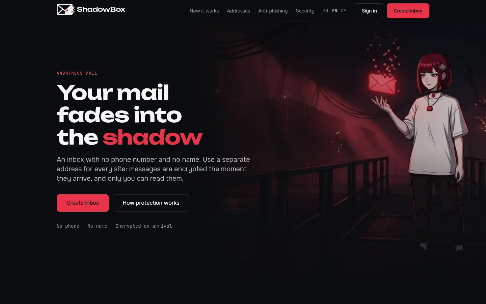
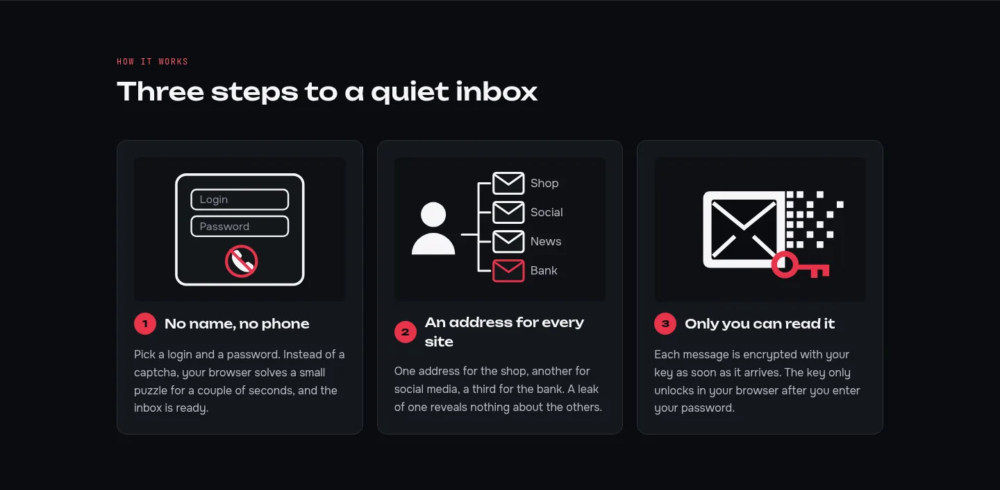
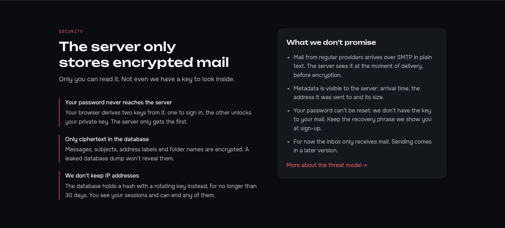
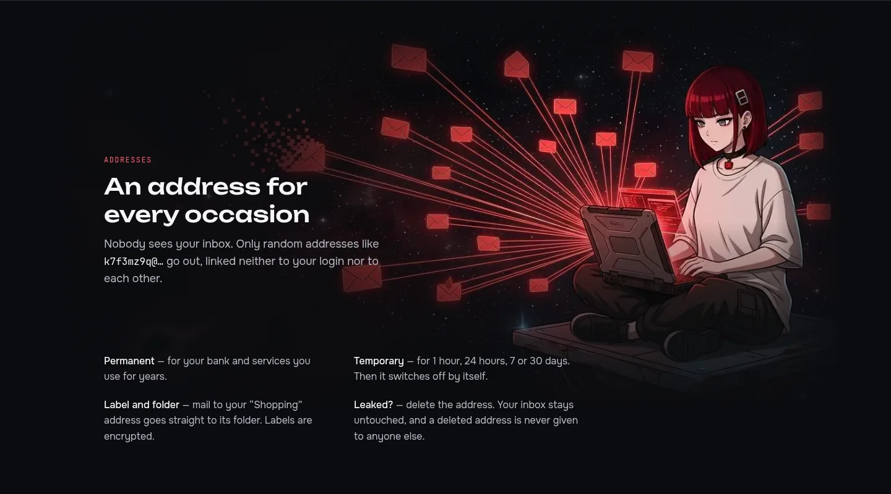
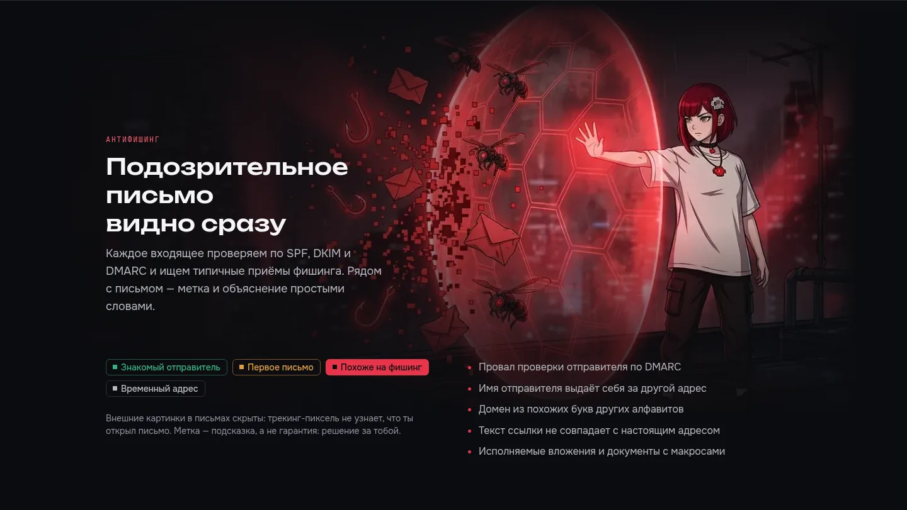
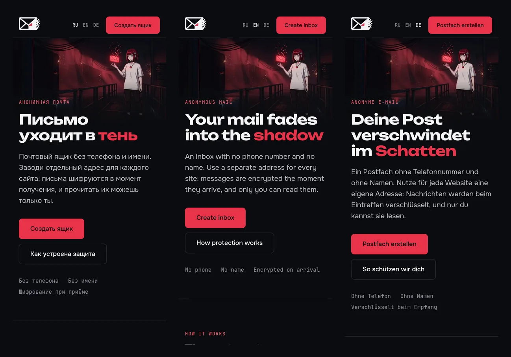
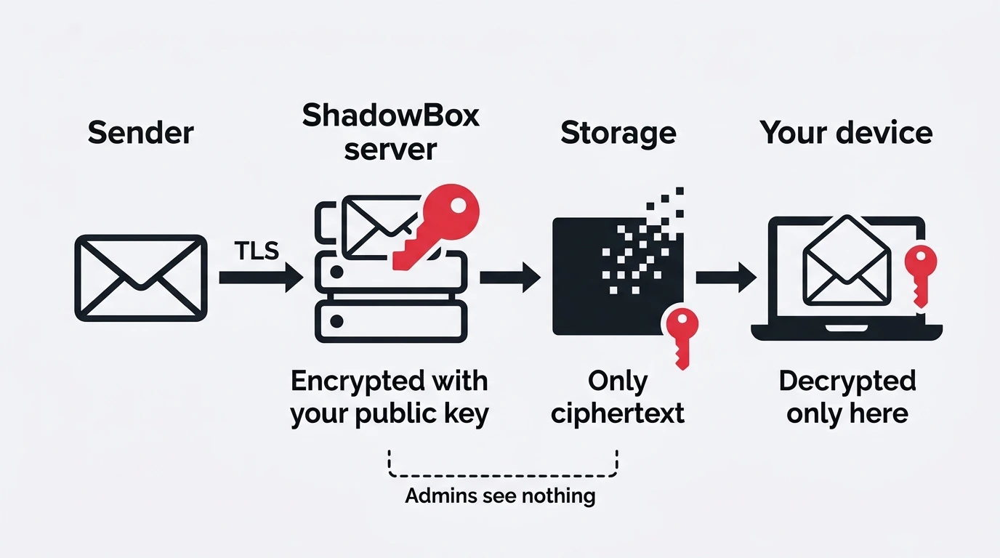
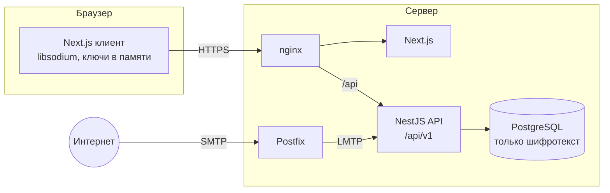

<p align="center">
  <a href="README.md">English</a> · <b>Русский</b> · <a href="README.de.md">Deutsch</a>
</p>

<p align="center">
  
</p>

<h1 align="center">ShadowBox</h1>

<p align="center">
  <b>Анонимная почта, которая не может прочитать твои письма.</b><br>
  Без телефона и имени. Отдельный адрес для каждого сайта. Шифрование в момент получения.
</p>

<p align="center">
  
  
  
  
  
  
</p>

<p align="center">
  <a href="#скриншоты">Скриншоты</a> ·
  <a href="#как-это-работает">Как это работает</a> ·
  <a href="#модель-угроз">Модель угроз</a> ·
  <a href="#технологии">Технологии</a> ·
  <a href="#запуск">Запуск</a> ·
  <a href="https://github.com/alexandra-seredkina/ShadowBox-Frontend">Фронтенд</a>
</p>

---

## О проекте

**ShadowBox** — почтовый сервис, который не знает, кто ты, и не может прочитать твои письма.

Регистрация — только логин и пароль. Для каждого сайта заводишь отдельный адрес: магазину один, банку другой, форуму третий. Входящее письмо шифруется твоим ключом в момент приёма, на сервере остаётся только шифротекст, а расшифровать его можно только в браузере после ввода пароля. Подозрительные письма помечаются ещё до того, как ты их откроешь.

Проект состоит из двух репозиториев:

| Репозиторий | Что внутри |
| --- | --- |
| **ShadowBox-Backend** (ты здесь) | API на NestJS, PostgreSQL, приём почты, nginx и docker-окружение |
| [ShadowBox-Frontend](https://github.com/alexandra-seredkina/ShadowBox-Frontend) | Веб-клиент на Next.js: сайт, регистрация, ящик, криптография в браузере |

## Скриншоты

<p align="center">
  
</p>

<table>
  <tr>
    <td width="50%"></td>
    <td width="50%"></td>
  </tr>
  <tr>
    <td width="50%"></td>
    <td width="50%"></td>
  </tr>
</table>

<p align="center">
  <br>
  <sub>Сайт на русском, английском и немецком, мобильная вёрстка</sub>
</p>

## Зачем это нужно

Сколько аккаунтов привязано к твоей почте? При регистрации почти везде просят почту, через неё же восстанавливают пароль. Ключ к почте — ключ ко всей цифровой жизни: получив один ящик, злоумышленник получает доступ почти ко всем сервисам, документам и перепискам.

И кому мы эту почту доверяем? [Яндекс признал](https://yandex.ru/company/news/2021-02-12), что сотрудник получил несанкционированный доступ к 4887 почтовым ящикам. [Google подтвердил](https://www.bbc.com/news/technology-44699263), что письма пользователей могут читать сторонние разработчики приложений, и это не противоречит его политике.

## Цели

Приоритеты проекта в таком порядке: **безопасность → анонимность → удобство**.

- 🔐 **Zero-access.** Сервер хранит только шифротекст. Ни администратор, ни украденный бэкап, ни утёкший дамп базы не дают прочитать письма.
- 🕶 **Минимум данных.** Не спрашиваем телефон, имя и запасную почту. Не храним IP в открытом виде, не пишем лишнего в логи.
- ✉️ **Адрес на каждый случай.** Случайные адреса не связаны ни с логином, ни друг с другом. Утёкший адрес удаляется в один клик и больше никому не выдаётся.
- 🛡 **Защита от фишинга.** SPF, DKIM, DMARC и эвристики против подмены отправителя, ссылок-обманок и опасных вложений.
- 🤝 **Честность.** Отдельно пишем, от чего сервис *не* защищает. Никаких «100% анонимности» и «военного шифрования».
- 🔎 **Проверяемость.** Открытый код под AGPL-3.0, SAST и аудит зависимостей на каждый pull request.

## Как это работает

<p align="center">
  
</p>

1. **Регистрация.** Браузер решает небольшую задачу proof-of-work вместо капчи, генерирует пару ключей X25519 и показывает recovery-фразу. Пароль на сервер не уходит: из него в браузере выводятся `authKey` (для входа) и `encKey` (открывает приватный ключ).
2. **Адреса.** Создаёшь постоянные или временные (1 ч, 24 ч, 7 или 30 дней) адреса. Подписи адресов и названия папок шифруются в браузере.
3. **Приём письма.** Внешний SMTP → Postfix → LMTP → модуль `delivery`. В памяти сервер проверяет SPF/DKIM/DMARC, ставит метки угроз, шифрует превью и всё письмо открытым ключом получателя и сохраняет только шифротекст.
4. **Чтение.** Браузер получает шифротекст, расшифровывает его ключом из памяти и показывает HTML-письма в изолированном `iframe` без скриптов и внешних картинок.

> [!NOTE]
> Письмо из обычной почты приходит по SMTP открытым текстом — так устроен протокол. Сервер видит его в момент приёма, до шифрования, и видит метаданные: время, адрес получателя и размер. Подпись «Admins see nothing» на схеме относится к содержимому писем в хранилище.

## Возможности MVP

| | Возможность | Статус |
| --- | --- | :---: |
| 👤 | Регистрация по логину и паролю, proof-of-work вместо капчи | ✅ |
| 🔑 | Ключи генерируются в браузере, приватный ключ живёт только в памяти вкладки | ✅ |
| ✉️ | Постоянные и временные адреса, подписи, папка для входящих | ✅ |
| 📥 | Приём почты с шифрованием в момент получения | 🚧 |
| 🛡 | Метки угроз и результат SPF/DKIM/DMARC человеческим языком | ✅ |
| 🗂 | Папки, массовые действия, поиск по расшифрованным письмам на клиенте | ✅ |
| 💻 | Список сессий, завершение любой, привязка сессии к IP по желанию | ✅ |
| 🌍 | Сайт на русском, английском и немецком | ✅ |

✅ готово · 🚧 в работе · 📋 запланировано

**Вне MVP:** отправка писем (сначала E2E между пользователями ShadowBox, затем во внешний интернет), 2FA (TOTP и passkeys), восстановление по recovery-фразе, PGP, прокси для картинок, переход на OPAQUE.

### Что уже сделано на бэкенде

- Строгий TypeScript и type-aware линтер, валидация окружения схемой `zod` — приложение не стартует с битым конфигом.
- Структурные логи `pino` с redact-списком, `requestId` в каждом ответе, единый формат ошибок API.
- Схема БД под MVP: UUIDv7, `timestamptz`, ограничения целостности на уровне PostgreSQL (адрес нельзя выдать повторно, письмо нельзя положить в чужую папку).
- Версионированный API `/api/v1`, проверка `Origin` на изменяющих запросах, лимит размера тела.
- Первые эндпоинты входа: `POST /auth/pow` (задача proof-of-work) и `POST /auth/prelogin` (параметры KDF; для несуществующего логина — правдоподобные фиктивные, чтобы нельзя было проверить, занят ли он).
- Регистрация `POST /auth/register`: сервер хранит только Argon2id от `authKey`, в одной транзакции создаются аккаунт, системные папки, первый адрес и сессия; повтор запроса с `Idempotency-Key` безопасен. Сессия — `HttpOnly`-cookie `__Host-`, в базе только SHA-256 токена и HMAC от IP.
- Тестовые векторы криптографии, общие с веб-клиентом: одинаковые входы дают одинаковые байты в браузере и на сервере.
- nginx без фиктивных заголовков и без версий в `Server`.

## Модель угроз

Противником считаются в том числе оператор сервера, утёкшая база и украденный бэкап. Каждое решение проверяется вопросом: *что узнает атакующий, получивший полный дамп базы, логов и диска?*

| Угроза | Что защищает | |
| --- | --- | :---: |
| Утечка базы данных или бэкапа | Письма, темы, подписи адресов и названия папок — только шифротекст | ✅ |
| Любопытный администратор | Ключи расшифровки есть только в браузере пользователя | ✅ |
| Подбор паролей и массовая регистрация | Argon2id, proof-of-work, rate limiting, одинаковый ответ для «нет логина» и «неверный пароль» | ✅ |
| Кража сессии через XSS | `HttpOnly`-cookie `__Host-`, `SameSite=Strict`, CSP с nonce, повторный ввод пароля для опасных действий | ✅ |
| Деанонимизация по регистрации | Телефон, имя и почта не запрашиваются; IP хранится только как HMAC с ротируемым ключом не дольше 30 дней | ✅ |
| Трекинг-пиксели и фишинг | Внешние картинки скрыты, HTML в изолированном `iframe`, метки угроз | ✅ |
| Метаданные: кто, кому и когда | Время, адрес получателя и размер письма серверу видны | ⚠️ |
| Внешний отправитель и его провайдер | Видят письмо до того, как оно дойдёт до нас | ❌ |
| Подмена JavaScript веб-клиента сервером | Код открыт, но веб-клиент получает JS с сервера | ⚠️ |
| Взломанное устройство пользователя | Вне зоны ответственности сервиса | ❌ |

Модель описывает целевую архитектуру MVP; что уже реализовано — в таблице возможностей выше.

## Архитектура



Бэкенд — модульный монолит: модули по бизнес-возможностям (`identity`, `alias`, `folder`, `message`, `threat`, `delivery`), внутри каждого слои `domain → application → infrastructure / presentation`. Границы слоёв проверяет линтер.

```
src/
├── config/            схема окружения и типизированный конфиг
├── shared/            ошибки, kernel-типы, HTTP-обвязка
├── infrastructure/    Prisma, криптография, логирование
├── modules/
│   ├── identity/      регистрация, вход, сессии
│   ├── alias/         постоянные и временные адреса
│   ├── folder/        папки
│   ├── message/       письма в зашифрованном виде
│   ├── threat/        метки угроз
│   └── delivery/      приём почты по LMTP
└── health/            /api/health
```

## Технологии

| Слой | Стек |
| --- | --- |
| **API** | NestJS 12 (ESM), TypeScript strict, zod, pino, helmet |
| **Данные** | PostgreSQL 18, Prisma 7, UUIDv7, `timestamptz` |
| **Криптография** | libsodium: Argon2id, X25519, XChaCha20-Poly1305 (`crypto_box_seal`) |
| **Почта** | Postfix → LMTP (`smtp-server`), `mailauth` для SPF/DKIM/DMARC, `postal-mime` |
| **Веб-клиент** | Next.js 16, React 19, Tailwind CSS 4, `libsodium-wrappers-sumo` — [подробнее](https://github.com/alexandra-seredkina/ShadowBox-Frontend) |
| **Инфраструктура** | Docker Compose, nginx, порты только на `127.0.0.1` |
| **Качество** | Vitest (unit и e2e), oxlint с type-aware правилами, Semgrep, `npm audit`, Dependabot |

## Запуск

Нужны Docker с Compose и оба репозитория рядом:

```
ShadowBox/
├── ShadowBox-Backend/
└── ShadowBox-Frontend/
```

```bash
cp .env.example .env    # задай свой POSTGRES_PASSWORD, PRELOGIN_SALT_KEY, IP_HASH_KEY и SENDER_HASH_KEY
docker compose up --build
```

| Адрес | Что |
| --- | --- |
| http://localhost:8080 | сайт и веб-клиент через nginx |
| http://localhost:8080/api/health | состояние API и базы |
| `127.0.0.1:5433` | PostgreSQL для Prisma Studio и миграций с хоста |
| `127.0.0.1:2424` | LMTP сервиса `delivery`, куда передаётся входящая почта |
| `127.0.0.1:2525` | SMTP локального Postfix: принимает почту для `shadowbox.test` и передаёт её в `delivery` |

Открывай именно `localhost` или `127.0.0.1`: браузер считает их безопасным контекстом, и `Secure`-cookie работают без HTTPS. Почтовый домен в разработке — `shadowbox.test`, он задаётся переменной окружения и нигде не зашит в коде.

Чтобы получить тестовое письмо, передай файл сервису `delivery` так же, как это делает почтовый сервер. Адрес — один из твоих адресов в веб-клиенте:

```bash
npm run mail:inject -- --to k7f3mz9q2a@shadowbox.test --file test/fixtures/mail/link-bait.eml
npm run mail:inject -- --to k7f3mz9q2a@shadowbox.test --large-mib 20
```

В `test/fixtures/mail/` лежат обычное письмо, подмена имени отправителя, домен-двойник, замаскированная ссылка, вложение `.exe` и пиксель слежения. `--client-ip` задаёт адрес отправителя для проверки SPF, `--from` — отправителя в конверте.

Или отправь письмо по настоящему SMTP через Postfix с помощью [swaks](https://www.jetmore.org/john/code/swaks/). Обрати внимание на `@` перед именем файла:

```bash
swaks --server 127.0.0.1:2525 --to k7f3mz9q2a@shadowbox.test --from news@shop.example --data @test/fixtures/mail/normal.eml
```

Postfix спрашивает сервис `delivery` о каждом получателе до того, как примет письмо: неизвестный или отключённый адрес получает `550` прямо в SMTP-диалоге, а для чужих доменов — `Relay access denied`. Очередь Postfix хранится только в памяти.

Код обоих репозиториев монтируется в контейнеры и перезагружается при изменениях. После смены зависимостей пересобери контейнеры с новыми томами:

```bash
docker compose up --build -V
```

Новая миграция после изменения `prisma/schema.prisma`:

```bash
npx prisma migrate dev --name <название>
```

### Проверки

```bash
npm run typecheck
npm run lint
npm test
npm run test:integration   # нужен DATABASE_URL одноразовой базы
npm run test:e2e
```

То же самое запускает CI на каждый pull request, плюс Semgrep и `npm audit`.

## Участие и безопасность

Идеи, критика и pull request'ы приветствуются. Безопасность — приоритет номер один, анонимность — номер два.

Нашёл уязвимость? Не открывай публичный issue — создай [приватное сообщение о уязвимости](https://github.com/alexandra-seredkina/ShadowBox-Backend/security/advisories/new) на GitHub.

## Лицензия

[AGPL-3.0](LICENSE). Если ты запускаешь изменённую версию ShadowBox как сервис, исходный код изменений должен быть доступен его пользователям.
